---
title: "Unterscheiden: Grundlagen"
slide-level: 2   # <— hier trennt Quarto an "##"
lightbox: true
css: global.css
format: 
  revealjs:
    fig-format: svg
    mermaid-format: svg
    out-width: "70%"
    fig-align: center
    width: 1400
    height: 1050
    auto-stretch: false
    theme: style.scss
    margin: 0.05
    slideNumber: true
    mermaid: 
      theme: neutral
      look: classic
      layout: dagre
editor: source
bibliography: methoden.bib
tbl-cap-location: bottom
execute: 
  echo: false
  cache: true
  message: false
  warning: false
--- 

## Neues aus der Wissenschaft!

::: callout-note
**Studie:** Hausfeld, Hampel, Bach & Menges (2026). *Putting assumptions to the test: A meta-analytic review of gender differences in emotional intelligence and specific emotion abilities.* Emotion. <https://doi.org/10.1037/emo0001733>
:::

<br> 
<br> 

**Frage:** Sind Frauen emotional intelligenter als Männer? Die Studie fasst dazu 1.279 Artikel mit 1.428 Stichproben und rund 609.000 Personen aus 76 Ländern zusammen.

<br> 
<br> 

[Zu den Shownotes](shownotes.html#gender-und-emotionale-intelligenz)

## Der große Bogen

{height="840px"}

## Geschlechtsspezifische Bildungsungleichheiten {.midi}

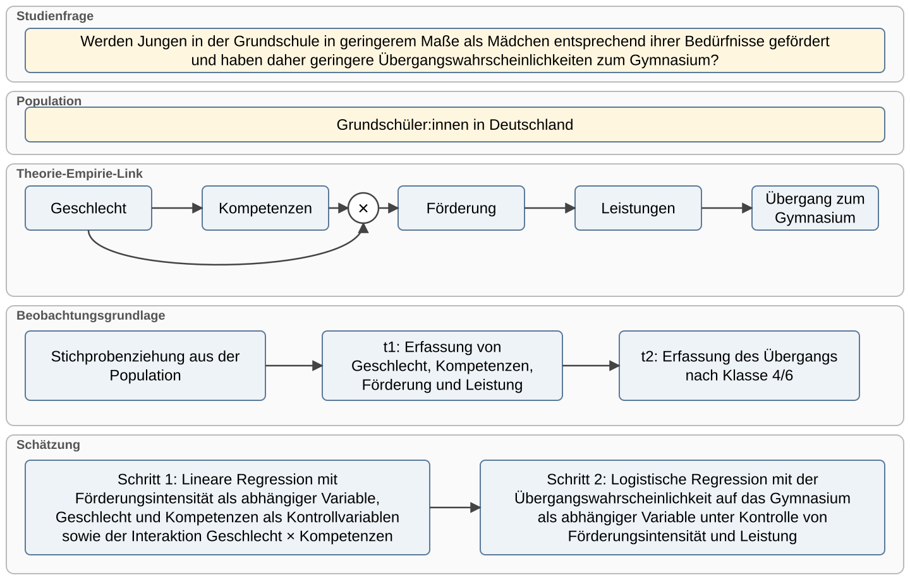

## Geschlechtsspezifische Bildungsungleichheiten {.midi}

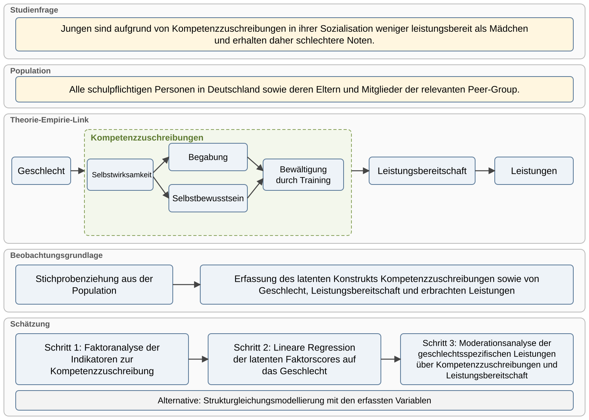

## Der Theorie-Empirie-Link

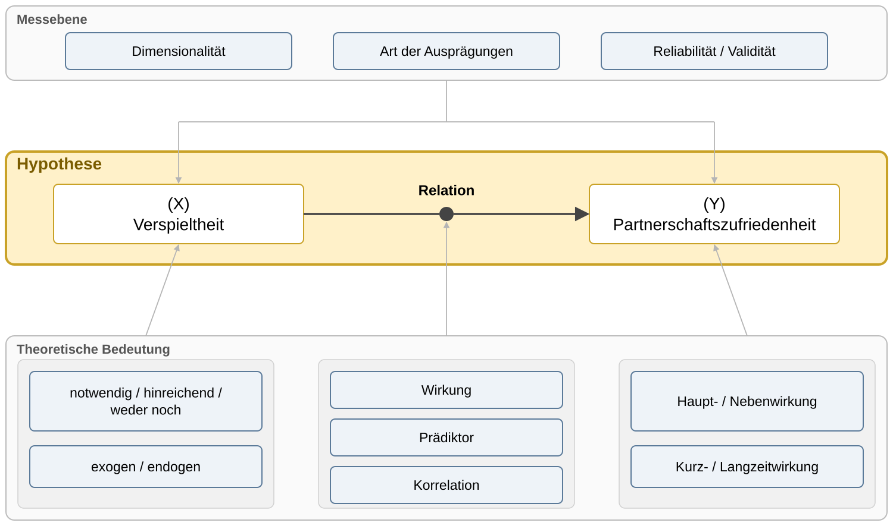

## Ziel 1: Gutes Unterscheiden

1.  **Klare Unterscheidungen**: Wir benötigen klar definierte Abgrenzungen von Eigenschaften und ihren relevanten Ausprägungen.

2.  **Sinnvolle Unterscheidungen**: Die getroffenen Unterscheidungen sind nützlich für eine wissenschaftliche Frage, weil sie relevante Eigenschaften zwischen den Gruppen trennen und relevante Unterschiede innerhalb der Gruppen (für die jeweilige Frage!) minimieren. 

3.  **Trennscharfe Unterscheidungen**: Beobachtungen sollen ein-eindeutig einer Ausprägung einer Eigenschaft zugeordnet werden können.

4.  **Relevante Unterscheidungen**: Die genutzten Unterschiede sollen zur Erklärung der (sozialen) Welt nützlich sein.

## Klare Unterscheidungen: Familien und andere Lebensformen

Forschungsfrage:  Wie haben sich Familienformen in den vergangenen Jahren entwickelt?

$\rightarrow$ Wir wollen dazu nur Familien **untereinander** abgrenzen.
  
$\rightarrow$ Dazu müssen wir allerdings Familien von anderen  Lebensformen abgrenzen. Dazu zählen dyadische Lebensformen (Ehe, Nichteheliche Lebensgemeinschaft), geteiltes Wohnen (WGs, Heimgemeinschaften), Alleinlebende

$\rightarrow$ Außerdem müssen wir Unterschiede familiärer Formen voneinander abgrenzen, wie z.B. Mehrgenerationfamilie, Einelternfamilie, Kleinfamilie, Großfamilie, Regenbogenfamilie, Pflegefamilie, Patchworkfamilie

## Familie, Paare, Haushalte {.nostretch}

{width="60%"}

## Unterschiede familiärer Lebensformen {.nostretch}

{width="50%"}

## Alternative Differenzierungen von Familien

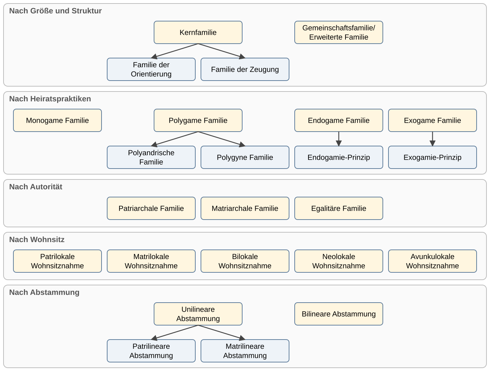{height="740px"}

[Zu den Shownotes](shownotes.html#alternative-differenzierungen-von-familien)


## Die Verteilung von Bedeutungen

::: columns
::: {.column width="30%"}

:::

::: {.column width="70%"}
Wir alle nutzen Schemata, um die Welt einzuteilen und miteinander zu kommunizieren. Wir verstehen uns, weil wir ähnliche Schemata aktivieren, wenn wir miteinander sprechen.

Allerdings gibt es auch eine erhebliche Variation bei der Aktivierung von gleichen Schemata (siehe Abb. links), was zu Missverständnissen führen kann.

Im Rahmen eines wissenschaftlichen Diskurses und vor allem im Rahmen einer wissenschaftlichen Studie gilt es, diese Missverständnisse und Unklarheiten dringend zu vermeiden.
::: 
:::

## Konzeptspezifikation {.nostretch}

{width="40%"}

## Was ist ein Konzept? {.midi}

Ein Konzept ist eine Menge von Informationen über Objekte, Merkmale oder Relationen. Die Information kann die *Extension* oder die *Intension* spezifizieren oder festlegen.

Die **Extension** eines Konzepts sind alle Dinge, die das Konzept umfasst.

```         
Die Extension des Konzepts *Familie* sind alle Familien in Abgrenzung zu allen nicht-familiären Lebensformen.
```

Die **Intension** eines Konzepts sind alle Eigenschaften, die den Einheiten innerhalb einer Extension gemeinsam sind.

```         
 Zur Intension des Konzepts *Familie* gehört mindestens: a) es gibt mindestens ein Kind b) es gibt mindestens eine Person, die in der Rolle eines Erziehungsberechtigten ist.
```

## Familie und Paar: Überschneidende Konzepte

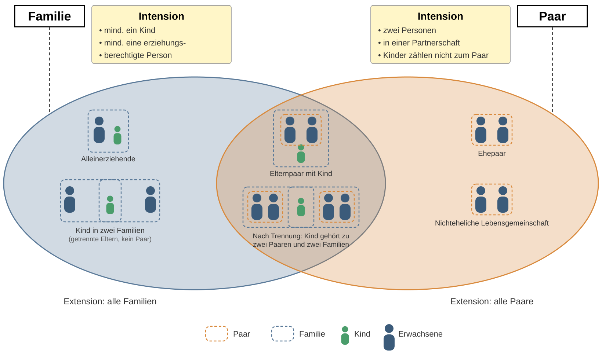

## Warum das alles?

Wir möchten klare Unterscheidungen u.a. von:

a) **Untersuchungseinheiten**

- In einer Untersuchung über Familien sollten daher keine Paare ohne Kinder auftauchen. Aber gelten getrennt lebende Ehepaare mit Kindern als eine Familie oder zwei? Was ist mit Patchwork-Familien oder Personen, die mehrere Haushalte aber nur eine Familie führen? 

b)  **Eigenschaften**

- Familien und Paare können u.a. mehr oder weniger *konflikthaft*, *vermögend* oder *entfremdet* sein. Diese Eigenschaften müssen sauber von ihrem nächsten "Verwandten" abgegrenzt werden: *konflikthaft* vs. *emotional unreguliert*; *Vermögen* vs. *Einkommen*; *Entfremdung* vs. *Kommunikationsstile*.

c)  Ausprägungen von Eigenschaften
  
-  Wie viele Familienformen müssen/sollten wir (für welche Frage) unterscheiden? Welche Grade der *Entfremdung* sollten wir unterscheiden? 


## Konzepte und Unterscheidungen

Wenn wir von Konzepten sprechen, beziehen wir uns daher typischerweise auf Schemata über Untersuchungseinheiten, Eigenschaften oder Ausprägungen.

Zwei Konzepte A und B voneinander zu unterscheiden, bedeutet daher zu beschreiben, welches intensionale Merkmal A hat aber B nicht hat. **Das ist die Aufgabe von Definitionen.**

Eine Definition legt die Extension eines Konzepts mittels einer Menge von intensionalen Merkmalen fest. D.h.: Mit einer Definition wird festgelegt, welche Untersuchungseinheiten oder Ausprägungen zu einem Konzept gehören. 

Die Festlegung erfolgt durch **mindestens ein Merkmal, das allen Gegenständen gemeinsam ist und das eine definierte Menge von anderen Mengen unterscheidet**.

## Der Zweck von Definitionen & Beschreibungen

Der Zweck einer Definition innerhalb der Wissenschaft ist es daher, Mengen von Gegenständen zu konstruieren, die sich gegenseitig ausschließen. 

Bei einer Definition handelt es sich *nur* um eine sprachliche Regel. Mit Definitionen können keine empirischen Aussagen getroffen werden. Sie sind weder richtig noch falsch sondern nur -- in Bezug auf eine Fragestellung -- nützlich oder weniger nützlich.

Eine Beschreibung ist die die Identifikation eines Objekts unter mindestens ein Konzept. Die Beschreibung eines gleichen Objekts unterscheidet sich daher, wenn für sie unterschiedliche Konzepte verwendet werden.

Beschreibungen setzen daher im Gegensatz zu Definitionen keine Regeln, sondern sie wenden (definitorische) Regeln zur Einordnung von Dingen an.

## Die Bedeutung guter Konzepte

::: columns
::: {.column width="55%"}
- Klare Beschreibungen benötigen klare Konzepte, da eine Beschreibung die Einordnung einer Beobachtung *B* unter ein Konzept *K* der Form "B ist eine Realisation von K" ist. 

-  Wenn Sie Eigenschaften oder Ausprägungen *A* und *B*  voneinander unterscheiden wollen, müssen Sie spezifizieren, welche Intension *A* hat, die *B* nicht hat. Dazu müssen wir *A* und *B* nicht erschöpfend beschreiben. Wir benötigen aber mindestens eine klare Trenn-Eigenschaft. 
:::

::: {.column width="45%"}
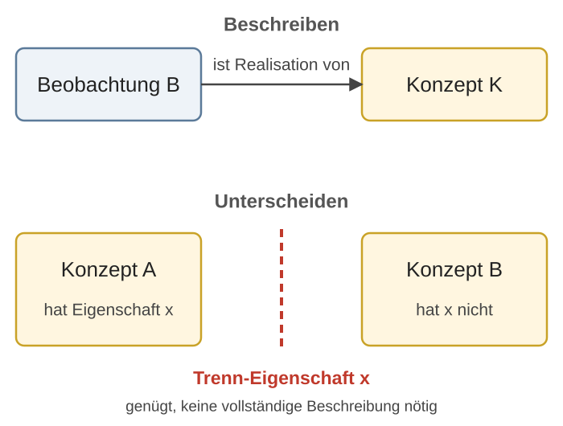
:::

:::

## Frage 2: Sinnvolle Unterscheidungen 

Sauber getrennte Unterscheidungen müssen nicht zwangsläufig **sinnvolle** Unterscheidungen sein.

Eine Unterscheidung ist sinnvoll, wenn 

a) alle *für eine Fragestellung* relevanten Differenzen zwischen Untersuchungseinheiten, Eigenschaften oder Ausprägungen erfasst wurden *und* 

b) innerhalb der unterschiedenen Gruppen keine *für die Fragestellung* relevanten Unterschiede übersehen wurden. 

## Unterscheidung von In-Group/Out-Group auf Nationalstaatsebene

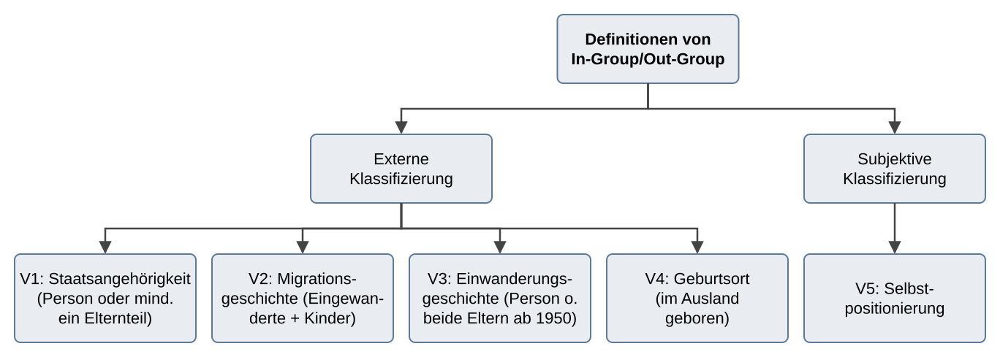

## Staatsbügerschaft

**Definition:**
Eine Person hat einen Migrationshintergrund, wenn **sie selbst oder mindestens ein Elternteil nicht mit deutscher Staatsangehörigkeit geboren wurde**.

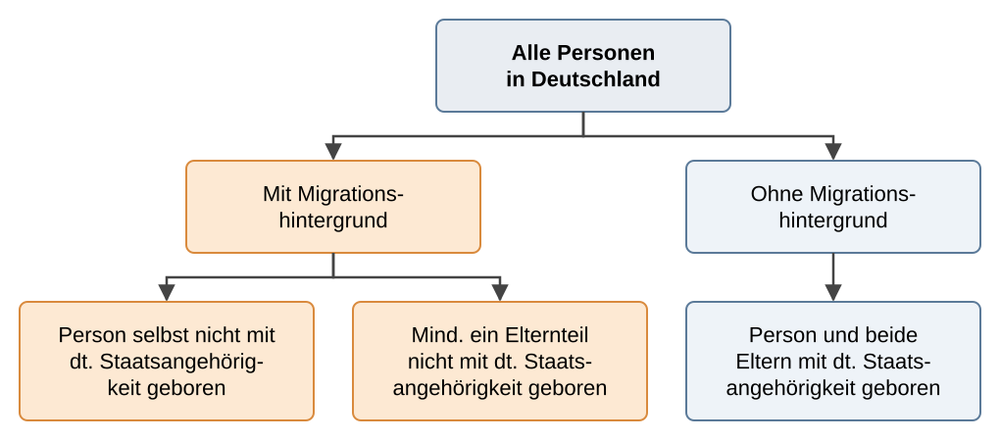

Probleme: 

- Aussiedler (u.a. "Russlanddeutsche"), in der DDR geborene, einbürgerte Personen werden der Gruppe "Ohne Migrationshintergrund" zugeordnet.
- Die dritte migrantische Generation wird als "ohne Migrationshintergrund" klassifiziert, wobei diese Gruppe von ungleicher Behandlung aufgrund askriptiver Merkmale betroffen sein könnte.


## Personen mit Migrationsgeschichte

Eine Person gehört zu dieser Gruppe, wenn sie selbst eingewandert ist oder direkte Nachkommen eines Eingewanderten ist.

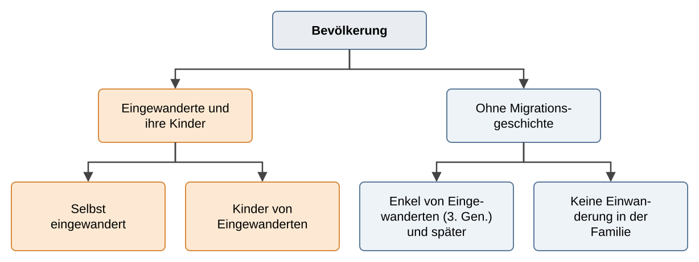

## Personen mit Einwanderungsgeschichte

**Definition:**
Eine Person gehört zu dieser Gruppe, **wenn sie oder beide Elternteile seit 1950 ins heutige Bundesgebiet eingewandert sind**.

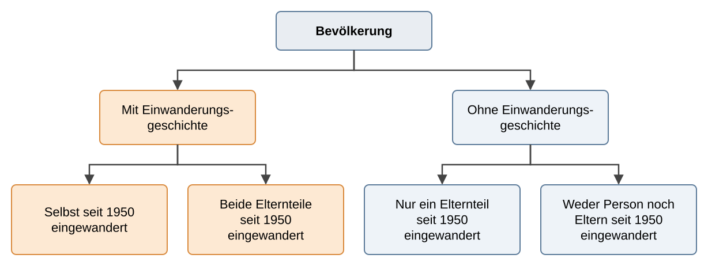

## Geburtsortsdefinition

**Definition:**
Eine Person gehört zu dieser Gruppe, **wenn sie ins heutige Bundesgebiet eingewandert ist**.

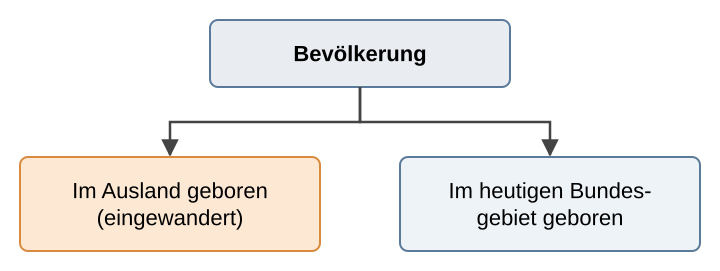

## Subjektive Einordnung in Mehrheits- oder Minderheitsgruppe

**Definition:**
Eine Person gehört zu dieser Gruppe, wenn sie sich zu einer ethnischen oder religiösen Minderheit zählt, die ihren ihren "Ursprung" nicht im Land verortet (z. B. "Afrikanisch", "Schwarz", "Muslimisch").

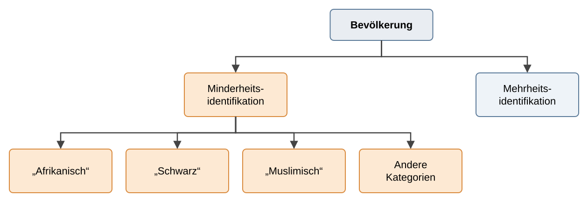

## Does it matter? 

!(Quelle: @milewskiBevolkerungMitMigrationshintergrund2024)[https://www.bib.bund.de/DE/Publikationen/Broschueren/Online/Bilder/Pyramiden-Migration/Die-Bevoelkerung-mit-Migrationshintergrund-neu-entdecken-Abb1.png]
