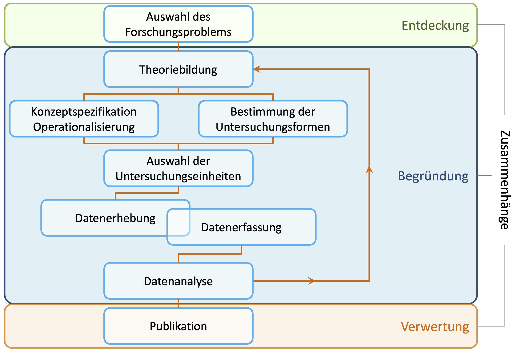
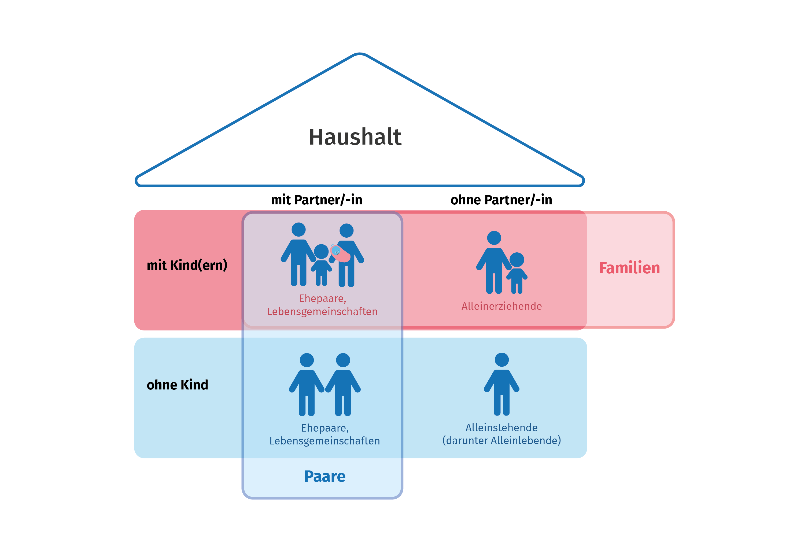
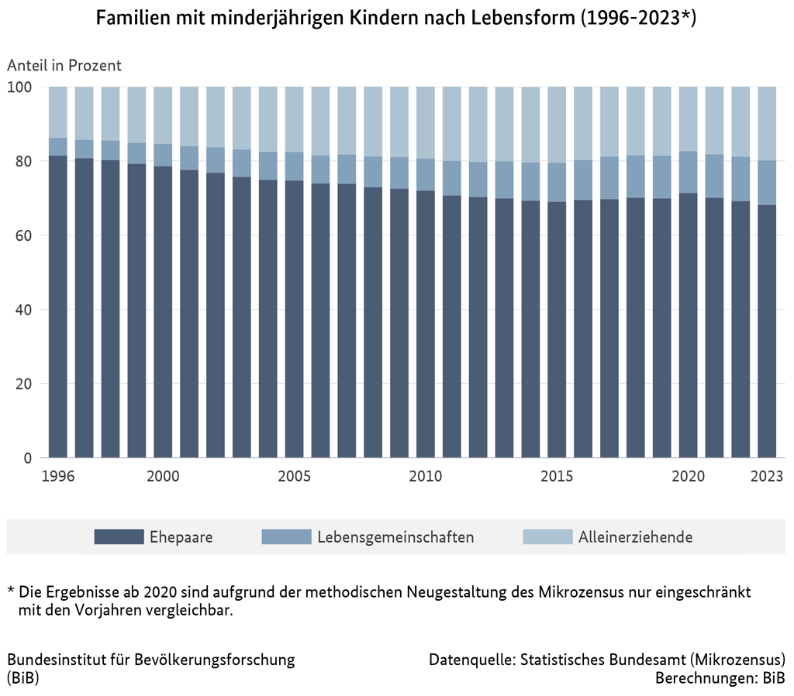
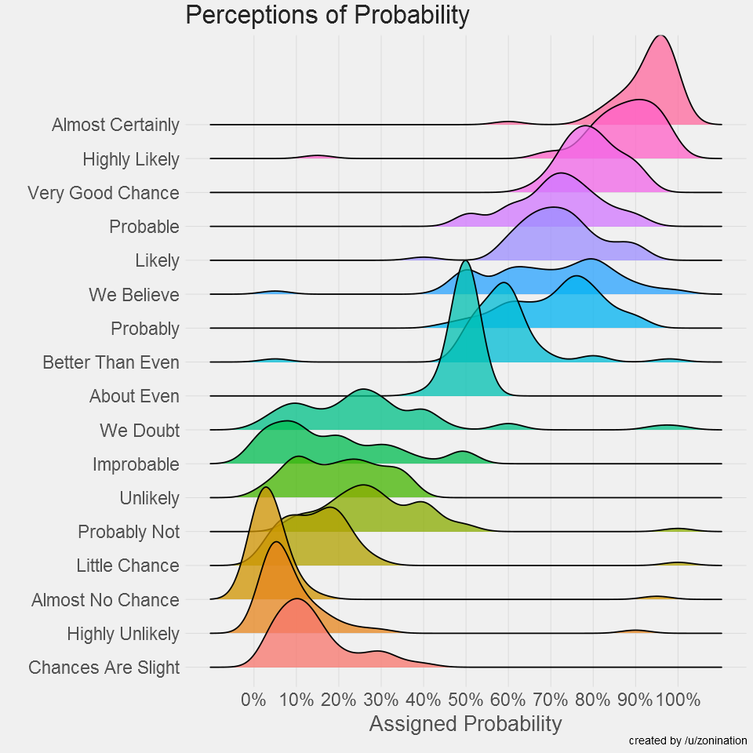

---
title: "Unterscheiden: Grundlagen"
slide-level: 2   # <— hier trennt Quarto an "##"
lightbox: true
css: global.css
format: 
  revealjs:
    fig-format: svg
    mermaid-format: svg
    out-width: "70%"
    fig-align: center
    width: 1400
    height: 1050
    auto-stretch: false
    theme: style.scss
    margin: 0.01
    slideNumber: true
    mermaid: 
      theme: neutral
      look: classic
      layout: dagre
editor: source
tbl-cap-location: bottom
execute: 
  echo: false
  cache: true
  message: false
  warning: false
--- 


## Forschung - wie geht das? {.nostretch}

{width="70%"}

## Erkentnisinteresse: Geschlechtsspezifische Bildungsungleichheiten {.midi}


## Erkentnisinteresse: Geschlechtsspezifische Bildungsungleichheiten {.midi}



## Der große Bogen

```{dot}
//| fig-width: 100%
//| fig-alt: "Der große Bogen von der Hypothese über Operationalisierung und Forschungsdesign zur Datenerhebung und Vergleich"
//| 
digraph {
  rankdir = TB;
  compound = true;
  bgcolor = "transparent";
  nodesep = 1.0;
  ranksep = 1.2;
  newrank = true;
  sep = "+0.5,0.5";
  
  # Node defaults
  node [shape = box, style = "rounded", fillcolor = "#ffffff", 
        fontname = "Arial", fontsize = 12, margin = "0.4,0.25"];
  edge [color = "#333333", arrowhead = vee, minlen = 2, fontsize = 12, penwidth = 1.5];
  
  # Hypothese
  subgraph cluster_H {
    label = "Hypothese";
    fontname = "Arial Bold";
    fontsize = 13;
    labelloc = "t";
    style = "filled,rounded";
    fillcolor = "#f9f9f9";
    color = "#999999";
    margin = 8;
    clusterrank = global;
    
    H_X [label = "X"];
    H_Y [label = "Y"];
    H_X -> H_Y [label = "führt zu"];
  }
  
  # Parent-Cluster für Operationalisierung und Forschungsdesign
    
    # Operationalisierung (links)
    subgraph cluster_O {
      label = "Operationalisierung";
      fontname = "Arial Bold";
      fontsize = 13;
      labelloc = "t";
      style = "filled,rounded";
      fillcolor = "#f9f9f9";
      color = "#999999";
      margin = 8;
      clusterrank = global;
      
      O_X [label = "Unterschiede\nin X"];
      O_Y [label = "Unterschiede\nin Y"];
      O_X -> O_Y [label = "stehen in\nBeziehung zu"];
    }
    
    # Forschungsdesign (rechts)
    subgraph cluster_FD {
      label = "Forschungsdesign";
      fontname = "Arial Bold";
      fontsize = 13;
      labelloc = "t";
      style = "filled,rounded";
      fillcolor = "#f9f9f9";
      color = "#999999";
      margin = 8;
      
      
      FD_UE [label = "Forschungsdesign"];
      FD_R [label = "Art der Zuweisung zu \n Untersuchungsgruppen"];
      FD_T [label = "Anzahl\nMesszeitpunkte"];
      FD_SD [label = "Stichprobendesign"]; 
      FD_SR [label = "Stichprobenrahmen"];
      FD_SA [label = "Stichprobenart"];

      FD_UE -> FD_R [arrowhead = "none"];
      FD_UE -> FD_T [arrowhead = "none"];
      FD_SD -> FD_SA
      FD_SD -> FD_SR
    }
    
 
  
  # Datenerhebung
  subgraph cluster_D {
    label = "Datenerhebung";
    fontname = "Arial Bold";
    fontsize = 13;
    labelloc = "t";
    style = "filled,rounded";
    fillcolor = "#f9f9f9";
    color = "#999999";
    margin = 8;
    
    D_S [label = "Stichprobe"];
    D_UE [label = "Untersuchungs-\neinheiten"];
    D_B [label = "Beobachter:innen"];
    
    D_S -> D_UE [label = "Quelle von"];
    D_UE -> D_B [label = "Beschreibung" dir = back];
    

  }
  
  # Vergleich / Modellierung
  subgraph cluster_V {
    label = "Vergleich / Modellierung";
    fontname = "Arial Bold";
    fontsize = 13;
    labelloc = "t";
    style = "filled,rounded";
    fillcolor = "#f9f9f9";
    color = "#999999";
    margin = 8;
    
    V_X0 [label = "📊\nVerteilung von\nY bei X = 0", shape = "box"];
    V_X1 [label = "📊\nVerteilung von\nY bei X = 1", shape = "box"];
    V_D [label = "Differenz", shape = "none"]
    V_X0 -> V_D [dir = back];
    V_D -> V_X1
  }
  
  # Rank-Constraint: O und FD auf gleicher Höhe (horizontal nebeneinander)
  {rank = same; H_X; O_X; FD_SD; FD_UE D_S; V_X0}
  
  # Verbindungen zwischen den Hauptclustern
  H_X -> O_X [ltail = cluster_H, lhead = cluster_O, label = "wird übersetzt zu", labelangle = 45, labeldistance = 2.0];
  O_X -> FD_SD [ltail = cluster_O, lhead = cluster_FD, label = "bedingt", labelangle = 45, labeldistance = 2.0]; 
  FD_UE -> D_S [ltail = cluster_FD, lhead = cluster_D, label = "Rahmen für", labelangle = 45, labeldistance = 2.0];
  D_S -> V_X0 [ltail = cluster_D, lhead = cluster_V, label = "Grundlage für", labelangle = 45, labeldistance = 2.0];
}

```

## Unterschiede, die Unterschiede machen {.midi}

](./images/sprachkompetenz.png)


## Ziele {.midi}

1.  **Klare Unterscheidungen**: Wir benötigen Klar definierte Abgrenzungen von Eigenschaften und ihren relevanten Ausprägungen.

2.  **Sinnvolle Unterscheidungen**: Wir nutzen geeignete Daten, die die erwarteten Ausprägungen zuverlässig abbilden können.

3.  **Trennscharfe Unterscheidungen**: Beobachtungen sollen ein-eindeutig einer Ausprägung einer Eigenschaft zugeordnet werden können.

4.  **Relevante Unterscheidungen**: Die genutzten Unterschiede sollen zur Erklärung der (sozialen) Welt nützlich sein.

## Klare Unterscheidungen: Familien und andere Lebensformen {.midi}

-   Wie haben sich Familienformen in den vergangenen Jahren entwickelt?

$\rightarrow$ Wir wollen dazu nur Familien **untereinander** abgrenzen.

```         
Dazu müssen wir allerdings Familien von anderen  Lebensformen abgrenzen. Dazu zählen dyadische Lebensformen (Ehe, Nichteheliche Lebensgemeinschaft), geteiltes Wohnen (WGs, Heimgemeinschaften), Alleinlebende
```

$\rightarrow$ Außerdem müssen wir Unterschiede familiärer Formen voneinander abgrenzen, wie z.B. Mehrgenerationfamilie, Einelternfamilie, Kleinfamilie, Großfamilie, Regenbogenfamilie, Pflegefamilie, Patchworkfamilie

## Familie, Paare, Haushalte {.nostretch}

{width="60%"}

## Unterschiede familiärer Lebensformen {.nostretch}

{width="50%"}

## Unterschiedliche Möglichkeiten der Differenzierung von Familien

```{mermaid}
flowchart TD
    subgraph S1["Nach Größe und Struktur"]
        B1[Kernfamilie]
        B2[Gemeinschaftsfamilie/Erweiterte Familie]
        B1 --> B1a[Familie der Orientierung]
        B1 --> B1b[Familie der Zeugung]
    end

    subgraph S2["Nach Heiratspraktiken"]
        C1[Monogame Familie]
        C2[Polygame Familie]
        C3[Endogame Familie]
        C4[Exogame Familie]
        C2 --> C2a[Polyandrische Familie]
        C2 --> C2b[Polygyne Familie]
        C3 --> C3a[Endogamie-Prinzip]
        C4 --> C4a[Exogamie-Prinzip]
    end

    subgraph S3["Nach Autorität"]
        D1[Patriarchale Familie]
        D2[Matriarchale Familie]
        D3[Egalitäre Familie]
    end

    subgraph S4["Nach Wohnsitz"]
        E1[Patrilokale Wohnsitznahme]
        E2[Matrilokale Wohnsitznahme]
        E3[Bilokale Wohnsitznahme]
        E4[Neolokale Wohnsitznahme]
        E5[Avunkulokale Wohnsitznahme]
    end

    subgraph S5["Nach Abstammung"]
        F1[Unilineare Abstammung]
        F2[Bilineare Abstammung]
        F1 --> F1a[Patrilineare Abstammung]
        F1 --> F1b[Matrilineare Abstammung]
    end
```


## Am Anfang ist das Wort {.midi}

::: columns
::: {.column width="30%"}

:::

::: {.column width="70%"}
Wir alle nutzen Schemata, um die Welt einzuteilen und miteinander zu kommunizieren. Wir verstehen uns, weil wir ähnliche Schemata aktivieren, wenn wir miteinander sprechen.

Allerdings gibt es auch eine erhebliche Variation bei der Aktivierung von gleichen Schemata (siehe Abb. links), was zu Missverständnissen führen kann.

Im Rahmen eines wissenschaftlichen Diskurses und vor allem im Rahmen einer wissenschaftlichen Studie gilt es diese Missverständnisse dringend zu vermeiden.
:::
:::

## Konzeptspezifikation {.nostretch}

](images/Konzept.png){width="40%"}

## Was ist ein Konzept? {.midi}

Ein Konzept ist eine Menge von Informationen über Objekte, Merkmale oder Relationen. Die Information kann die *Extension* oder die *Intension* spezifizieren oder festlegen.

Die **Extension** eines Konzepts sind alle Dinge, die das Konzept umfasst.

```         
Die Extension des Konzepts *Familie* sind alle Familien in Abgrenzung zu allen nicht-familiären Lebensformen.
```

Die **Intension** eines Konzepts sind alle Eigenschaften, die den Einheiten innerhalb einer Extension gemeinsam sind.

```         
 Zur Intension des Konzepts *Familie* gehört mindestens: a) es gibt mindestens ein Kind b) es gibt mindestens eine Person, die in der Rolle eines Erziehungsberechtigten ist.
```

## Warum das alles? {.midi}

Wir möchten klare Unterscheidungen u.a. von:

-   Untersuchungseinheiten

    ```         
    In einer Untersuchung über Familien sollten daher keine Paare ohne Kinder auftauchen. Aber gelten getrennt lebende Ehepaare mit Kindern als eine Familie oder zwei? Was ist mit Patchwork-Familien oder Personen, die mehrere Haushalte aber nur eine Familie führen? 
    ```

-   Eigenschaften

    ```         
    Versuchen Sie es mal: ADHS & Hochsensibilität; Mental Load & Stress; Zufriedenheit & Glück
    ```

-   Ausprägungen von Eigenschaften

    ```         
    Wie viele Familienformen, Geschlechter, Bildungsformen, Organisationstypen und Regierungsformen müssen/sollten wir unterscheiden? 
    ```

## Konzepte und Unterscheidungen

Wenn wir von Konzepten sprechen, beziehen wir uns daher typischerweise auf Schemata über Untersuchungseinheiten, Eigenschaften oder Ausprägungen.

Zwei Konzepte A und B voneinander zu unterscheiden, bedeutet daher zu beschreiben, welches intensionale Merkmal A hat aber B nicht. Das ist die Aufgabe von Definitionen.

## Unterschiede festlegen ist Aufgabe von Definitionen

Eine Definition legt die Extension eines Konzepts mittels einer Menge von intensionalen Merkmalen fest. D.h.: Mit einer Definition wird festgelegt, welche Untersuchungseinheiten oder Ausprägungen zu einem Konzept gehören. Die Festlegung erfolgt durch mindestens ein Merkmal, das allen Gegenständen gemeinsam ist und das eine definierte Menge von anderen Mengen unterscheidet.

## Der Zweck von Definitionen

Der Zweck einer Definition innerhalb der Wissenschaft ist es daher, Mengen von Gegenständen zu konstruieren, die sich gegenseitig ausschließen. Bei einer Definition handelt es sich *nur* um eine sprachliche Regel. Mit Definitionen können keine empirischen Aussagen getroffen werden. Sie sind weder richtig noch falsch sondern nur nützlich oder weniger nützlich.

## Was unterscheidet Definitionen von Beschreibungen?

Eine Beschreibung ist die die Identifikation eines Objekts unter mindestens ein Konzept. Die Beschreibung eines gleichen Objekts unterscheidet sich daher, wenn für sie unterschiedliche Konzepte verwendet werden.

Beschreibungen setzen daher im Gegensatz zu Definitionen keine Regeln, sondern sie wenden (definitorische) Regeln zur Einordnung von Dingen an.

## Die Bedeutung guter Konzepte

 - Klare Beschreibungen benötigen klare Konzepte, da eine Beschreibung die Einordnung einer Beobachtung *B* unter ein Konzept *K* der Form "B ist eine Realisation von K" ist. 

  -  Wenn Sie Eigenschaften oder Ausprägungen *A* und *B*  voneinander unterscheiden wollen, müssen Sie spezifizieren, welche Intension *A* hat, die *B* nicht hat. Dazu müssen wir *A* und *B* nicht erschöpfend beschreiben. Wir benötigen aber mindestens eine klare Trenn-Eigenschaft. 
  

## Unterscheidung nach "Migrationshintergrund"

```{mermaid}
flowchart TD
    A["Definitionen von<br/>Migrationshintergrund"]
    A --> B["Externe<br/>Klassifizierung"]
    A --> C["Subjektive<br/>Klassifizierung"]
    B --> B1["Person ODER<br/>mind. 1 Elternteil<br/>nicht dt. Staatsang."]
    B --> B2["Personen ODER<br/>Elternteile seit 1950<br/>eingewandert"]
    B --> B3["Eingewanderte +<br/>direkte Nachkommen"]
    C --> C1["Selbst-<br/>positionierung"]
```

## Migrationshintergrund -- Version 1 ("Staatsbügerschaft")

**Definition:**
Eine Person hat einen Migrationshintergrund, wenn **sie selbst oder mindestens ein Elternteil nicht mit deutscher Staatsangehörigkeit geboren wurde**.

```{mermaid}
flowchart TD
    A["Alle Personen<br/>in Deutschland"]
    A --> B["Mit<br/>Migrationshintergrund"]
    A --> C["Ohne<br/>Migrationshintergrund"]
    B --> B1["Person selbst nicht<br/>mit dt. Staatsangehörigkeit<br/>geboren"]
    B --> B2["Min. ein Elternteil nicht mit <br/> dt. Staatsangehörigkeit geboren"]
    C --> C1["Beide Elternteile und<br/>Person selbst mit<br/>dt. Staatsangehörigkeit<br/>geboren"]
```

Probleme: 

- Aussiedler (u.a. "Russlanddeutsche"), in der DDR geborene, einbürgerte Personen werden der Gruppe "Ohne Migrationshintergrund" zugeordnet.
- Die dritte migrantische Generation wird als "ohne Migrationshintergrund" klassifiziert, wobei diese Gruppe von ungleicher Behandlung aufgrund askriptiver Merkmale betroffen sein könnte.


## Migrationshintergrund -- Version 2 ("Personen mit Migrationsgeschichte")

Eine Person gehört zu dieser Gruppe, wenn sie selbst eingewandert ist oder direkte Nachkommen eines Eingewanderten ist.
```{mermaid}
flowchart TD
    A[Bevölkerung] --> B[Eingewanderte und ihre Nachkommen]
    A --> C[Personen ohne Migrationsgeschichte]

    B --> B1[Direkt Eingewanderte]
    B --> B2[Kinder von Eingewanderten]
    B --> B3[Enkel von Eingewanderten]

    C --> C1[Dritte Generation oder später ohne Migrationsgeschichte]
```

## Migrationshintergrund -- Version 3 ("Personen mit Einwanderungsgeschichte")

**Definition:**
Eine Person gehört zu dieser Gruppe, **wenn sie oder beide Elternteile seit 1950 ins heutige Bundesgebiet eingewandert sind**.

## Migrationshintergrund -- Version 4
```{mermaid}
flowchart TD
    A[Bevölkerung] --> B[Personen mit Einwanderungsgeschichte]
    A --> C[Personen ohne Einwanderungsgeschichte]

    B --> B1[Person selbst seit 1950 eingewandert]
    B --> B2[Beide Elternteile seit 1950 eingewandert]
    B --> B3[Ein Elternteil seit 1950 eingewandert]

    C --> C1[Person und Eltern vor 1950 eingewandert oder nicht migriert]
```

## Migrationshintergrund -- Version 4 ("Geburtsortsdefinition")

**Definition:**
Eine Person gehört zu dieser Gruppe, **wenn sie ins heutige Bundesgebiet eingewandert ist**.

```{mermaid}
flowchart TD
    A[Bevölkerung] --> B[Im Land geboren]
    A --> C[Nicht im Land geboren]
```

## Migrationshintergrund -- Version 5 ("Subjektive Einordnung")

**Definition:**
Eine Person gehört zu dieser Gruppe, wenn sie sich zu einer ethnischen oder religiösen Minderheit zählt, die ihren ihren "Ursprung" nicht im Land verortet (z. B. "Afrikanisch", "Schwarz", "Muslimisch").

```{mermaid}
flowchart TD
    A[Bevölkerung] --> B[Minderheitsidentifikation]

    B --> B1["Afrikanisch"]
    B --> B2["Schwarz"]
    B --> B3["Muslimisch"]
    B --> B4["Andere Kategorien"]

    A --> C["Mehrheitsidentifikation"]
```

## Does it matter? 

!(Quelle: @milewskiBevolkerungMitMigrationshintergrund2024)[https://www.bib.bund.de/DE/Publikationen/Broschueren/Online/Bilder/Pyramiden-Migration/Die-Bevoelkerung-mit-Migrationshintergrund-neu-entdecken-Abb1.png]
