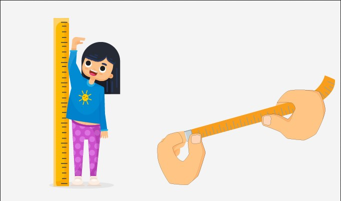
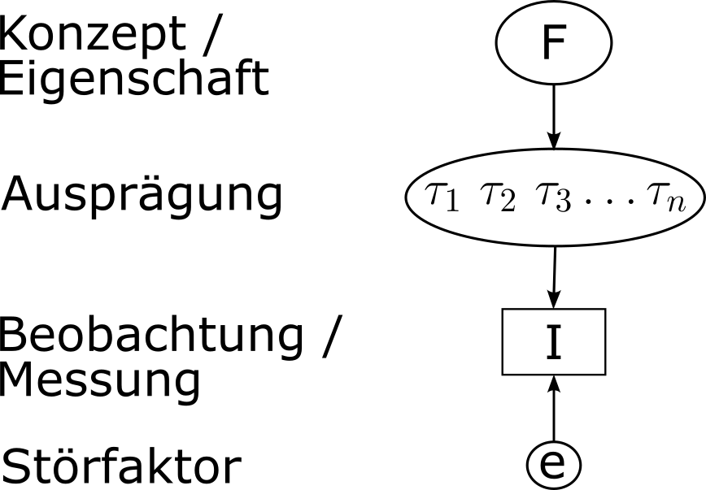
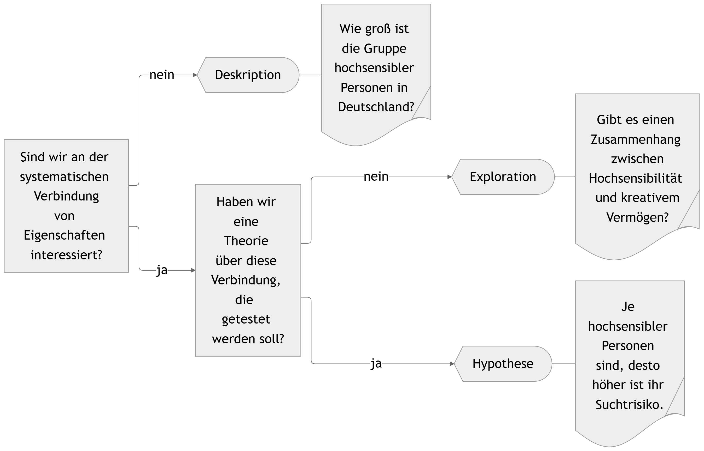
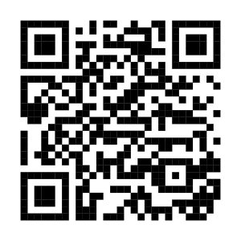

## Messen = Beobachtungen zu Ausprägungen einer Eigenschaft zuordnen {.midi}

::::: columns
::: {.column width="30%"}
 [Bildquelle](https://www.splashlearn.com/math-vocabulary/measurements/measurement)
:::

::: {.column width="70%"}
Wir wollen Untersuchungseinheiten hinsichtlich ihrer Ausprägungen von Eigenschaften unterscheiden. Dazu brauchen wir ein Symbol für jede (relevante) Ausprägung, die wir einer Beobachtung dieser Ausprägung zuordnen. In den meisten Fällen ist dieses Symbol eine Zahl. Die Anordnung dieser Zahlen/Symbole ist eine Skala.
:::
:::::

## Unterschiede der Körperkraft mit Greifkraftmessung

{width="80%"}

## Greifkraft messen - Was kann da schief gehen? {.smaller}

::: {.columns}
::: {.column width="50%"}
**Messverfahren im SOEP**

- Handdynamometer, bis zu vier Messungen pro Person für 2006 und 2008.
- Reihenfolge: erst rechts, dann links, jeweils wiederholt.
- Die erste Messung rechts dient teilweise als Probeversuch - sie ist systematisch niedriger als alle anderen.
:::

::: {.column width="50%"}
**Problem: Leute wissen manchmal nicht, was ihre dominante Hand ist.**

- Die dominante Hand wird per Selbstauskunft erfasst.
- Die Antworten sind 2006 und 2008 nicht hinreichend stabil.

**Lösung: Maximalwert aller Messungen nutzen**

- Höchster Wert aus der gesamten Messreihe, beider Hände.
- Unabhängig von der Selbstauskunft zur Händigkeit.
- Der Probeversuch-Effekt wirkt nicht mehr, weil nur der Höchstwert zählt.
- Höhere Fallzahl, da fehlende Einzelmessungen toleriert werden.
:::
:::

## Ist Greifkraft ein guter Indikator? {.midi}

Das kommt darauf an! :clown_face:

| Indikator für | Qualität |
|---|---|
| Gesamtmuskelkraft (Kinder, junge Erwachsene) | hoch, aber gewichtsabhängig |
| Einzelne Muskelgruppen (ältere Erwachsene) | schwach |
| Gesamtmortalität  | moderat |
| Gesamtmortalität  | moderat|
| Diabetes, Stürze, Frakturen  | null, komma nix |


## Unterschiede auf eine Skala bringen: Greifkraft 
```{r}
#| label: fig-greifkraft
#| fig-width: 10
#| out-width: "70%"

maxkraft <- data.frame(
  geschlecht = rep(c("Männer", "Frauen"), each = 7),
  altersgruppe = rep(c("0-29", "30-39", "40-49", "50-59", "60-69", "70-79", "80 und älter"), 2),
  mittel = c(50.4, 53.2, 52.6, 49.0, 44.8, 39.7, 31.9,
             31.7, 34.1, 34.0, 30.5, 28.4, 25.4, 20.3)
) |>
  transform(altersgruppe = factor(altersgruppe, unique(altersgruppe)))

ggplot(maxkraft, aes(altersgruppe, mittel, color = geschlecht, group = geschlecht)) +
  geom_line() +
  geom_point(size = 2.5) +
  labs(x = "Altersgruppe", y = "gemessenes Maximum der Greifkraft (kg)", color = "Geschlecht") +
  theme_minimal() +
  theme(
    legend.position = "inside",
    legend.position.inside = c(0.9, 0.98),
    legend.justification = c(0, 1),
    legend.background = element_rect(fill = "white", colour = "grey70"),
    panel.grid.major = element_line(colour = "grey80"),
    panel.grid.minor = element_line(colour = "grey90")
  )
```


## Unterschiede auf eine Skala bringen: Berufsprestige {.smaller}

::::: columns
::: {.column width="50%"}
](images/prestige-ausbildungsberufe.png)
:::

::: {.column width="50%"}
[Ebner & Rohrbach-Schmidt (2022)](https://www.degruyter.com/document/doi/10.1515/zfsoz-2021-0026/html) haben eine Skala für das soziale Ansehen von Berufen entwickelt.

Damit lassen sich Berufe nach ihrem Prestige unterscheiden und anhand einer Skala sortieren (links am Beispiel von Ausbildungsberufen).
:::
:::::

## Verhältnis von Eigenschaften, Ausprägungen, Beobachtungen und Fehlern {.smaller}

::::: columns
::: {.column width="30%"}

:::

::: {.column width="70%"}
Die Eigenschaft, von der wir ein Konzept formulieren, wird üblicherweise mit *F* abgekürzen.[^2] Unterschiedliche Ausprägungen der Eigenschaft werden mit $\tau_1 \dots \tau_n$ (sprich: Tau) abgekürzt. Die Beobachtung einer **Ausprägung** wird mit *I* abgekürzt.[^3] 

Beobachtungen können fehlerhaft sein. Die Quelle(n) einer fehlerhaften Beobachtung kürzen wir mit *e* ab (old school auch $\epsilon$, sprich: Epsilon.)
:::
:::::

[^2]: Kommt aus Großvaters Zeiten, in der alles ein *F*aktor war.

[^3]: Die Großväter (ja, es waren alles Männer) haben das *I*ndikator genannt.

## Verhältnis von Eigenschaften, Ausprägungen, Beobachtungen und Fehlern {.smaller}

::::: columns
::: {.column width="30%"}

:::

::: {.column width="70%"}
Beachten Sie bitte auch die Richtung der Pfeile im Graph!

Die Eigenschaft (oder wie wir sie konzeptualisieren) bestimmt die Anzahl und Art der Ausprägungen.

Pro Untersuchungseinheit ist eine Ausprägung einer Eigenschaft vorhanden.

Diese Ausprägung lässt sich beobachten und mit einem Symbol belegen.

Diese Beobachtung wird aber von einer Störquelle beeinflusst.
:::
:::::

## Überall Fehler {.smaller}

::::: {.columns}

:::: {.column width="30%"}
{width=100%}
::::

:::: {.column width="70%"}
 Das Messergebnis $y_i$ (= Beobachteter Wert der Variable $Y$ einer Untersuchungseinheit $i$) wird mindestens von zwei Komponenten bestimmt:

1.  die (wahre) Ausprägung eines Merkmals $\tau$ (sprich: tau) sowie

2.  einem Störfaktor $\epsilon$ (sprich: epsilon), den wir zunächst als zufällig betrachten.

Wir gehen oft davon aus, dass sich beide Komponenten *additiv* verhalten und damit gilt: 

$y_i = \tau_i + \epsilon_i$
::::
:::::

## Konzeptspezifikation - reminder {.midi}

:::::{.columns}

::::{.column width="40%"}
](images/Konzept.png){width="90%"}
::::

::::{.column width="60%"}
Operationalisierung ist die Darlegung, wie wir Konzepte über Indikatoren messbar machen können. 

Die Messung durch diese Indikatoren sollen

  - möglichst geringe Fehler beeinhalten;
  - mit **anderen** (Sub)Konzepten möglichst wenig korrelieren;
  - zuverlässig mit Konzepten, die gemessen werden sollen, korrelieren. 
::::
::::: 


## Latente und manifeste Eigenschaften

Wir können Eigenschaften danach unterscheiden, ob wir bei der Beobachtung ihrer Ausprägungen Störquellen annehmen oder nicht: 

```{mermaid}
flowchart TB
    E["Eigenschaften"] -- Störquelle ausgeschlossen --> M["Manifest"]
    E -- Störquelle angenommen --> L["Latent"]
    M --- M1["Alter"] & M2["Torvorlagen"] & M3["Blutgruppe"]
    L --- L1["Einstellungen"] & L2["Armut"] & L3["Einsamkeit"]

```

Das ist eine *pragmatische* Unterscheidung, die wir bei jeder Eigenschaft so oder so treffen können (siehe: Fühlen Sie sich öfter einsam?)

## Alles fliest - vor allem pragmatische Unterschiede

```{mermaid}
flowchart TB

B([Biologisches <br> Alter])
A[Angegebenes <br> Alter]
E1((Erinnerungsfehler)) 
E2((Keine <br> Geburtsurkunde))
E3((Vordatierung))
E4((Rückdatierung))

E1@{ shape: text}
E2@{ shape: text}
E3@{ shape: text}
E4@{ shape: text}

B --> A ~~~ E1 & E2 & E3 & E4
E1 & E2 & E3 & E4 --> A
```


## Warum das alles? 



## Hochsensibilität: Das Konzept {.midi}

Elaine N. Aron führte dieses Konzept ein, um Menschen danach zu unterscheiden, wie **stark und schnell sie Reize verarbeiten**.

Ursprünglich als *eindimensionale* Eigenschaft gedacht, wird Hochsensibilität heute meist in **drei Dimensionen** unterschieden.

```{mermaid}
flowchart TB
    H([Hochsensibilität])
    E([Leichte <br> Erregbarkeit])
    L([Niedrige <br> Wahrnehmungsschwelle])
    S([Hohe <br> Empfindsamkeit])
    H --> E & L & S
```


## Hochsensibilität: Das Konzept {.midi}
Hochsensibilität ist ...

1. **mehrdimensional** → wir brauchen Items für jede Dimension;
2. **latent** → jede einzelne Antwort ist eine fehlerbehaftete Beobachtung, daher mehrere Items pro Dimension.


## Abgrenzung: Hochsensibilität und ADHS {.smaller}

| | Hochsensibilität | ADHS |
|---|---|---|
| **Status** | Persönlichkeitsmerkmal | Diagnose |
| **Kern** | Reize werden *gründlich und tief* verarbeitet | Aufmerksamkeit und Impulse können schlecht *gesteuert* werden |
| **Reizüberflutung** | Folge der intensiven Verarbeitung → Rückzug, Ruhe suchen | Folge mangelnder Reizfilterung → teils auch Suche nach neuen Reizen |

: Gängige konzeptionelle Abgrenzung, u.a. nach [Aron, Aron & Jagiellowicz (2012)](https://doi.org/10.1177/1088868311434213).

## Ist die Abgrenzung gut? {.smaller}

Empirisch überschneiden sich beide: Wer mehr ADHS-Merkmale berichtet, berichtet auch mehr Reizempfindlichkeit.

| ADHS-Merkmale | Hochsensibilität gesamt | Leichte Erregbarkeit | Niedrige Wahrnehmungsschwelle | Ästhetische Sensibilität |
|---|:---:|:---:|:---:|:---:|
| Gesamt | .36 | .31 | .34 | .21 |
| Unaufmerksamkeit | .33 | .32 | .32 | .16 |
| Hyperaktivität/Impulsivität | .32 | .25 | .31 | .22 |

: Korrelationen (Kendalls τ) in einer Stichprobe aus der britischen Allgemeinbevölkerung (*n* = 694), beide Merkmale per Selbstauskunft. Quelle: [Schippers, Hoogman & Greven (2025)](https://doi.org/10.1016/j.crbeha.2025.100193)

Für die Messung heißt das: Ein guter Hochsensibilitätstest sollte mit ADHS-Skalen möglichst *wenig* korrelieren. Die Zusammenhänge sind mittelstark, aber weit von 1 entfernt: Hochsensibilität und ADHS überschneiden sich, sind aber nicht dasselbe -- am stärksten teilen sie die Neigung zu Überreizung (Erregbarkeit, Wahrnehmungsschwelle).

## Der HSP-Test für Hochsensibilität {.smaller}

[HSP-Test von Satow (2022)](https://www.testarchiv.eu/de/test/9008351): 

| | Langform | Kurzform |
|------------|:---:|:---:|
| Leichte Erregbarkeit (EOE, *Ease of Excitation*) | 8 Items | 3 Items |
| Niedrige Wahrnehmungsschwelle (LST, *Low Sensory Threshold*) | 8 Items | 3 Items |
| Hohe Empfindsamkeit (HSE, *High Sensitivity*) | 8 Items | 3 Items |
| **Gesamt** | **24 Items** | **9 Items** |

Alle Items werden auf derselben vierstufigen Skala beantwortet:

*trifft gar nicht zu* -- *trifft eher nicht zu* -- *trifft eher zu* -- *trifft genau zu*

Die Items der Dimensionen sind im Fragebogen gemischt, damit sich die Befragten nicht an "Blöcken" orientieren.

## Mitmachen: Wie hochsensibel sind wir? {.midi}

::::: columns
::: {.column width="45%"}
{width="90%"}
:::

::: {.column width="55%"}
Scannen Sie den QR-Code oder öffnen Sie

<https://shiny-appserver.org/hochsensibilitaet/>

9 Aussagen, ca. 1 Minute. Die Teilnahme ist freiwillig und anonym; gezeigt werden nur zusammengefasste Ergebnisse.

Fragebogen: Kurzform des HSP-Tests für Hochsensibilität ([Satow 2022](https://www.testarchiv.eu/de/test/9008351)).
:::
:::::

## Die Langform: 24 Items in drei Dimensionen {.smaller}

```{=html}
<div id="hsp-lang">
<style>
  #hsp-lang { font-size: 0.68em; }
  #hsp-lang .root { text-align: center; margin: 0 auto 0.4em; }
  #hsp-lang .root span { display: inline-block; border: 2px solid #333; border-radius: 8px;
    padding: 0.15em 0.8em; font-weight: bold; font-size: 1.2em; }
  #hsp-lang .cols { display: grid; grid-template-columns: repeat(3, 1fr); gap: 0.8em; }
  #hsp-lang .dim { border: 1px solid #999; border-radius: 8px; padding: 0.4em; }
  #hsp-lang .dim h4 { margin: 0 0 0.4em; font-size: 1em; text-align: center; line-height: 1.2; }
  #hsp-lang .chips { display: grid; grid-template-columns: 1fr 1fr; gap: 0.3em; }
  #hsp-lang .chip { border: 1px solid #777; border-radius: 6px; padding: 0.15em 0.4em;
    cursor: pointer; background: #fff; line-height: 1.25; }
  #hsp-lang .chip.kurz { background: #c8c8c8; }
  #hsp-lang .chip:hover, #hsp-lang .chip.active { outline: 3px solid #e80; }
  #hsp-lang .chip .nr { font-weight: bold; color: #555; margin-right: 0.3em; }
  #hsp-lang .info { margin-top: 0.6em; min-height: 3.4em; border-left: 6px solid #e80;
    background: #f5f5f5; padding: 0.4em 0.7em; font-size: 1.15em; }
  #hsp-lang .info .meta { font-size: 0.75em; color: #555; }
  #hsp-lang .legend { margin-top: 0.4em; font-size: 0.8em; color: #444; }
  #hsp-lang .legend .chip { cursor: default; display: inline-block; }
</style>

<div class="root"><span>Hochsensibilität</span></div>
<div class="cols">
  <div class="dim"><h4>Leichte Erregbarkeit (EOE)</h4><div class="chips" data-dim="EOE"></div></div>
  <div class="dim"><h4>Niedrige Wahrnehmungsschwelle (LST)</h4><div class="chips" data-dim="LST"></div></div>
  <div class="dim"><h4>Hohe Empfindsamkeit (HSE)</h4><div class="chips" data-dim="HSE"></div></div>
</div>
<div class="info"><span class="meta">Item anklicken oder mit der Maus darüberfahren, um den Originalwortlaut zu sehen.</span></div>
<div class="legend"><span class="chip kurz">grau</span> = auch in der Kurzform &nbsp; <span class="chip">weiß</span> = nur Langform &nbsp; Zahl = Position im Fragebogen &nbsp; (–) = negativ formuliert</div>

<script>
(function () {
  const root = document.getElementById("hsp-lang");
  const items = [
    ["EOE",  3, "aus der Ruhe",        "Kleinigkeiten bringen mich sehr schnell aus der Ruhe.", true],
    ["EOE",  5, "rege mich auf",       "Ich rege mich oft zu schnell auf.", true],
    ["EOE",  7, "nervös",              "Ich werde schnell nervös.", false],
    ["EOE",  9, "weine",               "Ich weine schnell.", false],
    ["EOE", 13, "Nachrichten",         "Schlechte Nachrichten beunruhigen mich sehr schnell.", false],
    ["EOE", 16, "erregbar",            "Ich bin leicht erregbar.", true],
    ["EOE", 21, "Grübeln",             "Wenn mich etwas beunruhigt, kann ich oft an nichts anderes mehr denken.", false],
    ["EOE", 24, "Konzentration",       "Wenn ich aufgeregt bin, fällt es mir sehr schwer, mich auf eine Sache zu konzentrieren.", false],
    ["LST",  1, "bemerke zuerst",      "Es passiert häufig, dass ich der Erste bin, der etwas wahrnimmt, beispielsweise riecht oder hört.", true],
    ["LST",  2, "Licht",               "Ich bin sehr lichtempfindlich.", false],
    ["LST",  4, "Flackern",            "Flackerndes Licht kann ich nur sehr schwer ertragen.", false],
    ["LST",  8, "Geräusche",           "Störende Geräusche (tiefes Brummen, hohes Pfeifen) nehme ich intensiver wahr als andere.", true],
    ["LST", 11, "Details",             "Ich nehme oft Kleinigkeiten wahr, die andere übersehen oder gar nicht erst bemerken.", false],
    ["LST", 17, "Geschmack",           "Ich habe äußerst empfindliche Geschmacksnerven.", false],
    ["LST", 22, "ausblenden",          "Ich kann störende Geräusche oft nicht ausblenden.", false],
    ["LST", 23, "Gerüche",             "Ich rieche unangenehme Dinge deutlicher als andere.", true],
    ["HSE",  6, "was in mir vorgeht",  "Ich versuche immer genau zu wissen, was in mir vorgeht.", true],
    ["HSE", 10, "Gefühle & Gedanken",  "Ich beschäftige mich sehr viel mit meinen eigenen Gefühlen und Gedanken.", true],
    ["HSE", 12, "Entscheidungen",      "Ich weiß immer sehr genau, warum ich mich für oder gegen eine Sache entscheide.", false],
    ["HSE", 14, "Gefühle kennen",      "Ich kenne meine Gefühle sehr genau.", false],
    ["HSE", 15, "einfühlsam",          "Ich bin einfühlsamer als andere.", false],
    ["HSE", 18, "Nachdenken (–)",      "Ich bin kein Mensch, der viel über sich selbst nachdenkt.", false],
    ["HSE", 19, "Gefühle erforschen",  "Ich verbringe täglich mehrere Stunden damit, meine Gefühle zu erforschen.", false],
    ["HSE", 20, "Gefühle wahrnehmen",  "Meine eigenen Gefühle nehme ich sehr genau wahr.", true]
  ];
  const info = root.querySelector(".info");
  let pinned = null;

  function show(it) {
    const [dim, nr, , text, kurz] = it;
    info.innerHTML = "<b>Item " + nr + ":</b> „" + text + "“<br><span class='meta'>" +
      dim + (kurz ? " · Lang- und Kurzform" : " · nur Langform") +
      (nr === 18 ? " · negativ formuliert, Rohpunkte werden umgedreht" : "") + "</span>";
  }

  items.forEach(function (it) {
    const chip = document.createElement("div");
    chip.className = "chip" + (it[4] ? " kurz" : "");
    chip.innerHTML = "<span class='nr'>" + it[1] + "</span>" + it[2];
    chip.addEventListener("mouseenter", function () { show(it); });
    chip.addEventListener("mouseleave", function () { if (pinned) show(pinned.it); });
    chip.addEventListener("click", function () {
      if (pinned) pinned.el.classList.remove("active");
      pinned = { el: chip, it: it };
      chip.classList.add("active");
      show(it);
    });
    root.querySelector(".chips[data-dim='" + it[0] + "']").appendChild(chip);
  });
})();
</script>
</div>
```

::: aside
Quelle: [Satow (2022)](https://www.testarchiv.eu/de/test/9008351)
:::

## Kurzform (1/3): Leichte Erregbarkeit (EOE) {.smaller}

Personen mit hohen Werten sind leicht erregbar und schnell beunruhigt, besonders wenn viele Reize und Informationen gleichzeitig auf sie einströmen.

| Nr. | Item | trifft gar nicht zu | trifft eher nicht zu | trifft eher zu | trifft genau zu |
|:---:|---|:---:|:---:|:---:|:---:|
| 2 | Ich rege mich oft zu schnell auf. | ○ | ○ | ○ | ○ |
| 5 | Kleinigkeiten bringen mich sehr schnell aus der Ruhe. | ○ | ○ | ○ | ○ |
| 8 | Ich bin leicht erregbar. | ○ | ○ | ○ | ○ |

: Items der Dimension "Leichte Erregbarkeit" in der Kurzform. Nr. = Position im Fragebogen. Quelle: [Satow (2022)](https://www.testarchiv.eu/de/test/9008351)

## Kurzform (2/3): Niedrige Wahrnehmungsschwelle (LST) {.smaller}

Personen mit hohen Werten nehmen ihre Umwelt intensiver und oft früher wahr als andere -- z.B. Geräusche, flackerndes Licht oder Gerüche.

| Nr. | Item | trifft gar nicht zu | trifft eher nicht zu | trifft eher zu | trifft genau zu |
|:---:|---|:---:|:---:|:---:|:---:|
| 1 | Es passiert häufig, dass ich der Erste bin, der etwas wahrnimmt, beispielsweise riecht oder hört. | ○ | ○ | ○ | ○ |
| 4 | Ich rieche unangenehme Dinge deutlicher als andere. | ○ | ○ | ○ | ○ |
| 9 | Störende Geräusche (tiefes Brummen, hohes Pfeifen) nehme ich intensiver wahr als andere. | ○ | ○ | ○ | ○ |

: Items der Dimension "Niedrige Wahrnehmungsschwelle" in der Kurzform. Nr. = Position im Fragebogen. Quelle: [Satow (2022)](https://www.testarchiv.eu/de/test/9008351)

## Kurzform (3/3): Hohe Empfindsamkeit (HSE) {.smaller}

Personen mit hohen Werten beschäftigen sich intensiv mit ihren Gefühlen und inneren Vorgängen.

| Nr. | Item | trifft gar nicht zu | trifft eher nicht zu | trifft eher zu | trifft genau zu |
|:---:|---|:---:|:---:|:---:|:---:|
| 3 | Meine eigenen Gefühle nehme ich sehr genau wahr. | ○ | ○ | ○ | ○ |
| 6 | Ich beschäftige mich sehr viel mit meinen eigenen Gefühlen und Gedanken. | ○ | ○ | ○ | ○ |
| 7 | Ich versuche immer genau zu wissen, was in mir vorgeht. | ○ | ○ | ○ | ○ |

: Items der Dimension "Hohe Empfindsamkeit" in der Kurzform. Nr. = Position im Fragebogen. Quelle: [Satow (2022)](https://www.testarchiv.eu/de/test/9008351)

## Schritt 1: Antworten werden zu Rohpunkten {.smaller}

Jede Antwort erhält einen Zahlenwert -- je stärker die Zustimmung, desto mehr Punkte:

| trifft gar nicht zu | trifft eher nicht zu | trifft eher zu | trifft genau zu |
|:---:|:---:|:---:|:---:|
| 1 | 2 | 3 | 4 |

Damit gilt für jedes Item: **mehr Punkte = mehr Hochsensibilität**.

Ausnahme in der Langform: Item 18 *"Ich bin kein Mensch, der viel über sich selbst nachdenkt."* ist **negativ formuliert** -- Zustimmung bedeutet hier *weniger* Empfindsamkeit. Die Punkte werden daher umgedreht (*trifft genau zu* = 1, ..., *trifft gar nicht zu* = 4).

Die Kurzform enthält nur positiv formulierte Items.

## Schritt 2: Rohpunkte werden zu Dimensions- und Gesamtscores {.smaller}

::::: columns
::: {.column width="45%"}
```{mermaid}
flowchart LR
    I1[Item 2] & I2[Item 5] & I3[Item 8] --> E([EOE <br> 3–12])
    I4[Item 1] & I5[Item 4] & I6[Item 9] --> L([LST <br> 3–12])
    I7[Item 3] & I8[Item 6] & I9[Item 7] --> S([HSE <br> 3–12])
    E & L & S --> G([Gesamt <br> 9–36])
```
:::

::: {.column width="55%"}
**Dimensionsscore** = Summe der Rohpunkte der Items einer Dimension (Kurzform: 3 bis 12; Langform: 8 bis 32).

**Gesamtscore** = Summe der drei Dimensionsscores (Kurzform: 9 bis 36; Langform: 24 bis 96).

*Warum addieren?* Jedes Item ist eine fehlerbehaftete Beobachtung derselben Eigenschaft. In der Summe gleichen sich zufällige Ausreißer einzelner Antworten teilweise aus.

Für die Kurzform wurden pro Dimension die drei Items gewählt, die am stärksten mit den übrigen Items ihrer Dimension zusammenhängen.
:::
:::::

## Beispiel: Eine Person füllt die Kurzform aus {.smaller}

| Dimension | Antworten (Rohpunkte) | Dimensionsscore |
|---|:---:|:---:|
| Leichte Erregbarkeit (Items 2, 5, 8) | 3 + 4 + 3 | 10 |
| Niedrige Wahrnehmungsschwelle (Items 1, 4, 9) | 4 + 4 + 4 | 12 |
| Hohe Empfindsamkeit (Items 3, 6, 7) | 3 + 2 + 3 | 8 |
| **Gesamtscore** | | **30** |

Ist 30 von 36 Punkten viel? Das lässt sich erst im **Vergleich mit anderen Menschen** beantworten.


## Schritt 3: Vergleich mit einer Referenzgruppe {.smaller}

Der Score wird mit dem Durchschnitt (Mittelwert, *M*) und der typischen Abweichung vom Durchschnitt (Standardabweichung, *SD*) einer großen Vergleichsstichprobe (*n* = 65.280) verglichen und in einen **T-Wert** umgerechnet:

$$T = 50 + 10 \cdot \frac{\text{Score} - M}{SD}$$

T = 50 heißt "genau durchschnittlich", T = 60 heißt "eine typische Abweichung über dem Durchschnitt" (das erreichen nur rund 16 % der Vergleichsgruppe).

## Schritt 3: Vergleich mit einer Referenzgruppe {.smaller}

| | EOE | LST | HSE | Gesamt |
|---|:---:|:---:|:---:|:---:|
| Score der Person | 10 | 12 | 8 | 30 |
| *M* (*SD*) der Vergleichsgruppe | 9,40 (2,12) | 9,37 (2,02) | 10,07 (1,82) | 28,84 (4,05) |
| T-Wert | 53 | **63** | 39 | 53 |

**Regel:** Hochsensibilität liegt vor, wenn mindestens **zwei Dimensionen** oder der **Gesamtscore** einen T-Wert von 60 erreichen. Unsere Beispielperson ist also *nicht* hochsensibel -- trotz sehr niedriger Wahrnehmungsschwelle.


## Unsere Daten: Leichte Erregbarkeit (EOE)

<iframe src="https://shiny-appserver.org/hochsensibilitaet-live/?plot=EOE" width="100%" height="580" style="border:none;"></iframe>

## Unsere Daten: Niedrige Wahrnehmungsschwelle (LST)

<iframe src="https://shiny-appserver.org/hochsensibilitaet-live/?plot=LST" width="100%" height="580" style="border:none;"></iframe>

## Unsere Daten: Hohe Empfindsamkeit (HSE)

<iframe src="https://shiny-appserver.org/hochsensibilitaet-live/?plot=HSE" width="100%" height="580" style="border:none;"></iframe>

## Unsere Daten: Die drei Dimensionen im Vergleich

<iframe src="https://shiny-appserver.org/hochsensibilitaet-live/?plot=dims" width="100%" height="580" style="border:none;"></iframe>

## Unsere Daten: Gesamtscore

<iframe src="https://shiny-appserver.org/hochsensibilitaet-live/?plot=gesamt" width="100%" height="580" style="border:none;"></iframe>


